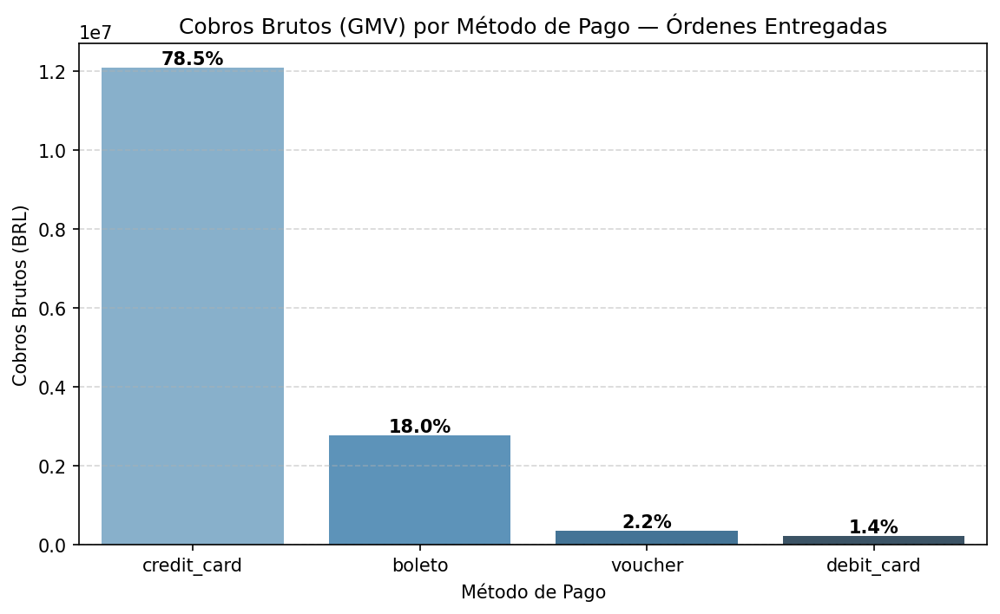
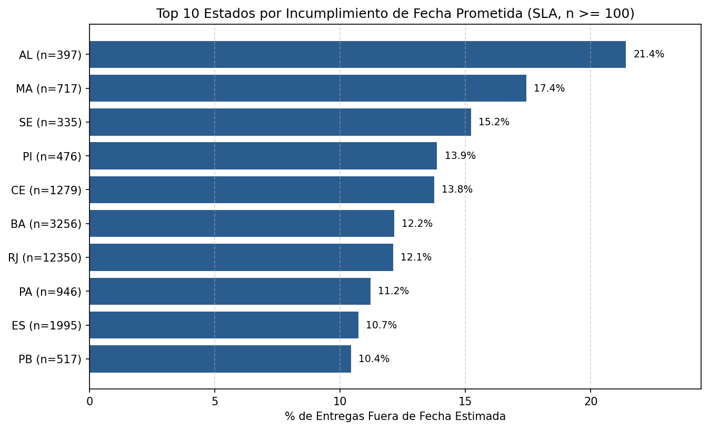

# 📊 Auditoría de Integridad Contable y Performance Logística — Olist E-commerce


**Autor:** Jonathan Monserrat ([@Jmonse](https://github.com/Jmonse))  
**Stack:** Python · SQL (SQLite) · pandas · Matplotlib · Seaborn · OpenPyXL  
**Universo Auditado:** 99.441 órdenes · 103.886 registros de pago · Dataset público Olist Brasil (Kaggle)

---

## 📌 Descripción y Enfoque de Auditoría

Proyecto de **Data Assurance y Control de Gestión** aplicado sobre el ecosistema de Olist (Brasil). A partir de la carga relacional de las tablas en un motor **SQLite**, se ejecutan pruebas sustantivas de integridad financiera, corte de operaciones (devengado) y cumplimiento de niveles de servicio logístico (SLA):

1. **Integridad de Ingresos y Cobros (Pruebas 1A y 1B):** Cruce relacional (`LEFT JOIN`) entre órdenes entregadas y registros de pago para identificar entregas sin respaldo financiero y transacciones con importes nulos o $\le 0$.
2. **Pasivos Contingentes / Reembolsos (Prueba 2):** Cuantificación de órdenes en estado `canceled` o `unavailable` que registran cobros efectivos, determinando la exposición financiera a devoluciones.
3. **Corte de Operaciones / Devengado (Prueba 3):** Identificación de operaciones aprobadas en un período contable ($t$) y entregadas en un período posterior ($t+1$), cuantificando anticipos de clientes / ingresos diferidos al cierre mensual.
4. **Performance Logística y SLA Normalizado (Prueba 4):** Evaluación de tiempos de entrega (*Lead Time*), tasa real de demora crítica ($>30$ días sobre órdenes entregadas) e incumplimiento de fecha prometida por estado, evitando el sesgo de conteos absolutos.

---

## 📈 Hallazgos Clave Auditados

| Prueba / Indicador | Resultado Verificado | Observación Técnica |
| :--- | :--- | :--- |
| **Total de Órdenes Auditadas** | 99.441 | Universo completo de transacciones en sistema |
| **Órdenes Entregadas (Base SLA)** | 96.470 | Denominador real para indicadores de entrega |
| **Entregas sin Respaldo de Pago (Prueba 1A)** | 1 orden (0,001%) | ID `bfbd0f9bdef84302105ad712db648a6c` |
| **Registros de Pago con Importe $\le 0$ (Prueba 1B)** | 9 registros | Anomalías de registro en tabla `payments` |
| **Órdenes Canceladas/No Disp. con Cobro (Prueba 2)** | 1.231 órdenes | **R$ 269.735,11** expuestos a pasivo por reembolso |
| **Corte Intermensual / Ingresos Diferidos (Prueba 3)** | 34.881 órdenes | **R$ 5.929.539,13** aprobados en mes $t$ y entregados en $t+1$ |
| **Tasa Global de Demora Crítica ($>30$ días)** | **4,27%** (4.117 / 96.470) | Estados más críticos: **AM (31,03%)**, **RR (29,27%)**, **AL (24,18%)** |
| **Incumplimiento de Fecha Prometida (SLA)** | **6,77%** | Mayor desvío contractual en **AL (21,41%)** y **MA (17,43%)** |
| **Medio de Pago Dominante (Devengado)** | Tarjeta de Crédito (**78,46%**) | R$ 12.101.094,88 sobre órdenes efectivamente entregadas |

---

## 📊 Visualizaciones

### Ingresos Devengados por Método de Pago (Órdenes Entregadas)


### Top 10 Estados por Tasa Real de Demora Crítica (>30 días)


---

## 📋 Recomendaciones de Control Interno

- **Controles de Cierre y Contingencias:** Implementar un bloqueo automático que impida marcar órdenes como `delivered` sin validación de cobro acreditado, y conciliar periódicamente las 1.231 órdenes canceladas/no disponibles con cobro (`R$ 269.735,11`) contra el auxiliar de reembolsos emitidos.
- **Reconocimiento de Ingresos (Devengado):** Automatizar el asiento de corte mensual para reclasificar como *Anticipos de Clientes* las órdenes aprobadas pendientes de entrega al último día hábil de cada mes (`R$ 5,93M` acumulados en el período auditado).
- **Gestión Logística Diferenciada:** Rediseñar los acuerdos con operadores logísticos en la región Norte/Nordeste (**AM, RR, AL, PA**), donde más de 1 de cada 5 entregas supera los 30 días, priorizando la reducción del incumplimiento contractual en **Alagoas (21,41% fuera de plazo)**.

---

## 🗂️ Estructura del Proyecto

```text
Auditoria-Olist-Ecommerce/
├── data/                  # Datasets CSV crudos de Kaggle (ignorados en Git)
├── docs/
│   └── img/               # Gráficos exportados en alta resolución
├── notebooks/
│   └── 01_Auditoria_Olist.ipynb   # Notebook con motor SQLite, pruebas y visualización
├── outputs/
│   └── reporte_auditoria_olist.xlsx # Reporte ejecutivo multi-hoja (4 pestañas)
├── sql/
│   └── auditoria_olist.sql        # Queries SQL estructuradas (CTEs, JOINs, SLA)
├── .gitignore
├── README.md
└── requirements.txt